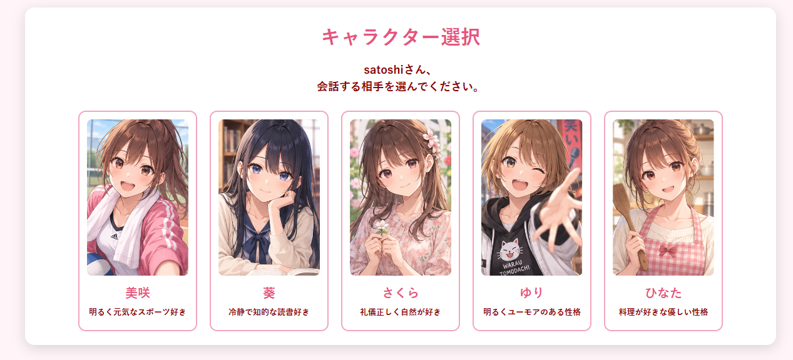
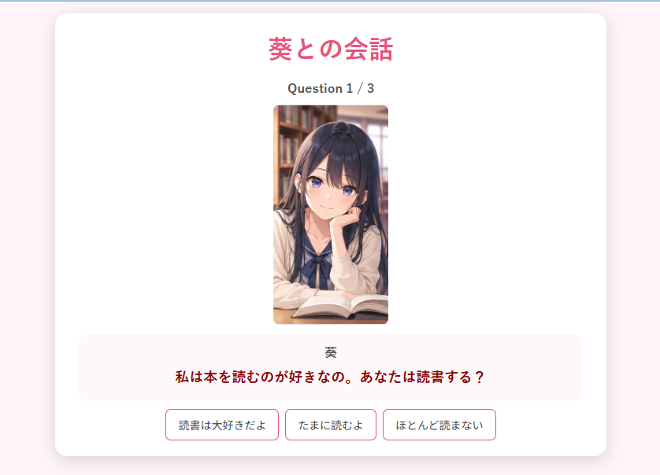
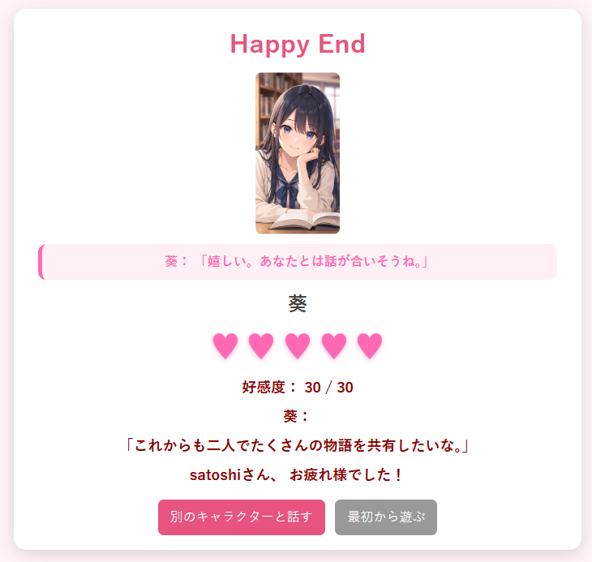
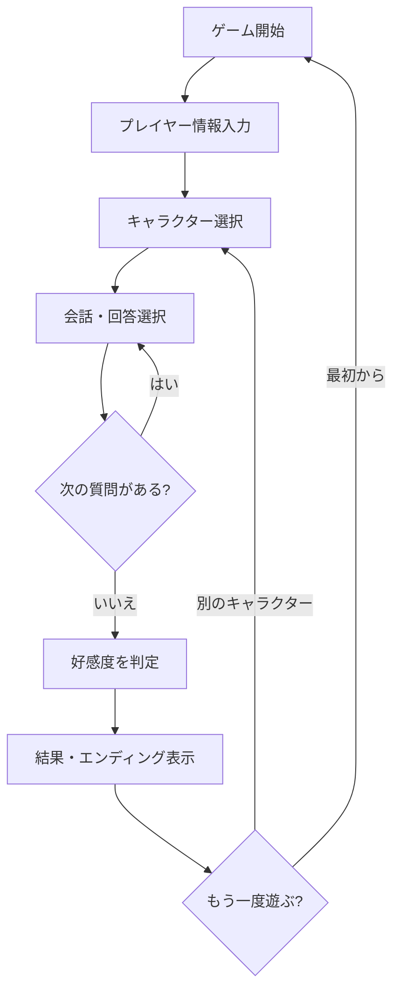
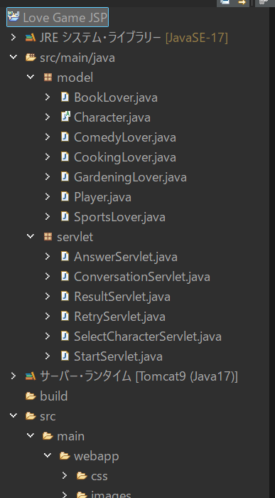
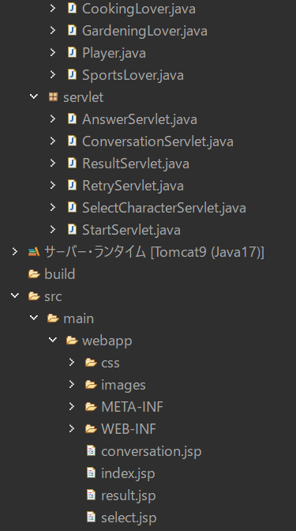
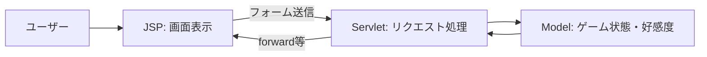

# LoveGame_JSP 💗

**Java Servlet / JSPで制作した、キャラクターとの会話を楽しむ恋愛シミュレーションゲームです。**

5人のキャラクターから会話相手を選び、質問への回答によって好感度が変化します。キャラクターごとに性格や会話の内容が異なり、選択結果に応じたエンディングを表示します。

> Javaのオブジェクト指向、Servlet/JSPによる画面遷移、セッション管理を学ぶための制作例です。

## スクリーンショット

### キャラクター選択



美咲・葵・さくら・ゆり・ひなたの5人から会話相手を選択します。

### 会話画面



キャラクターの質問に対し、表示された選択肢から回答します。画面には質問の進行状況も表示されます。

### エンディング



会話の結果に応じて好感度やメッセージを表示します。結果画面から別のキャラクターを選び直したり、最初から遊んだりできます。

## ゲームの流れ



## 使用技術

| 分類 | 技術 |
| --- | --- |
| 言語 | Java 17 |
| Web | Servlet / JSP（`javax.servlet`） |
| Webサーバー | Apache Tomcat 9 |
| フロントエンド | HTML / CSS |
| 開発環境 | Eclipse（動的Webプロジェクト） |

※ Tomcat 10以降の `jakarta.servlet` ではなく、Tomcat 9の `javax.servlet` を使用する構成です。

## プロジェクト構成

```text
LoveGame_JSP/
├── src/main/java/
│   ├── model/
│   │   ├── Character.java
│   │   ├── Player.java
│   │   ├── SportsLover.java
│   │   ├── BookLover.java
│   │   ├── GardeningLover.java
│   │   ├── ComedyLover.java
│   │   └── CookingLover.java
│   └── servlet/
│       ├── StartServlet.java
│       ├── SelectCharacterServlet.java
│       ├── ConversationServlet.java
│       ├── AnswerServlet.java
│       ├── ResultServlet.java
│       └── RetryServlet.java
└── src/main/webapp/
    ├── css/
    ├── images/
    ├── META-INF/
    ├── WEB-INF/
    ├── index.jsp
    ├── select.jsp
    ├── conversation.jsp
    └── result.jsp
```

### Eclipseでのプロジェクト構成





## クラスの役割

| 区分 | 主なクラス | 役割 |
| --- | --- | --- |
| Model | `Player` | プレイヤー情報の保持 |
| Model | `Character` | キャラクターに共通する属性・振る舞いの定義 |
| Model | `SportsLover` など | キャラクターごとの性格や会話の違いを表現 |
| Servlet | `StartServlet` | ゲーム開始処理 |
| Servlet | `SelectCharacterServlet` | 会話相手の選択 |
| Servlet | `ConversationServlet` | 会話画面への遷移 |
| Servlet | `AnswerServlet` | 回答の受け付け |
| Servlet | `ResultServlet` | 結果画面への遷移 |
| Servlet | `RetryServlet` | 再プレイ処理 |
| JSP | `index.jsp` など | HTML画面の表示 |

## Servlet/JSPの処理イメージ



- **JSP**：キャラクター画像・質問・選択肢・結果を表示
- **Servlet**：画面からのリクエストを受け、処理や画面遷移を制御
- **Model**：プレイヤー・キャラクターの情報やゲームの状態を管理

## 実行方法

1. Java 17、Eclipse、Apache Tomcat 9を用意します。
2. Eclipseへプロジェクトをインポートします。
3. プロジェクトのターゲット・ランタイムにTomcat 9を設定します。
4. Tomcat 9でプロジェクトを実行します。
5. ブラウザでアプリケーションの `index.jsp` にアクセスします。

URL例（コンテキストパスが `LoveGame_JSP`、ポートが8080の場合）：

```text
http://localhost:8080/LoveGame_JSP/index.jsp
```

## 学習ポイント

- **継承・多態性**：共通の`Character`を基にキャラクターごとの振る舞いを実装
- **責務の分離**：Model、Servlet、JSPで役割を分担
- **HTTPリクエスト**：フォーム送信とServletによる受信
- **画面遷移**：JSP間の遷移をServletで制御
- **状態管理**：会話相手や好感度など、画面をまたぐゲーム情報を扱う

## 今後の拡張案

- 会話イベント・選択肢の追加
- キャラクターごとのエンディングの充実
- 好感度の推移の可視化
- スマートフォン向けUIの改善

---

**LoveGame_JSP** — Javaのオブジェクト指向とServlet/JSPを組み合わせた学習用Webアプリケーション。
